# Isolation Forest phát hiện bất thường từ sự kiện của Suricata

Mã nguồn khóa luận tốt nghiệp **"Nghiên cứu ứng dụng thuật toán Isolation Forest trong phát hiện bất thường từ sự kiện an ninh mạng của Suricata"**.

- Sinh viên: Phạm Lê Hoàng Anh (24TX810002)
- Giảng viên hướng dẫn: ThS. Nguyễn Thanh Nhã

Đề tài xây dựng nhánh phát hiện bất thường chạy song song với nhánh chữ ký của Suricata, gồm hai mô-đun Isolation Forest học không giám sát trên nhật ký `eve.json`:

- **Behavior-IF**: bản ghi `flow`, đơn vị phân tích là cặp máy trong một cửa sổ thời gian. Mô-đun theo dõi hành vi lộ ra trong thời gian ngắn và có hai tham chiếu bình thường theo bên khởi tạo kết nối, cùng dùng cửa sổ 30 giây, bước trượt 15 giây. Chiều ra (máy nạn nhân khởi tạo) dùng 7 đặc trưng cho dò quét, dò đăng nhập sang vùng quản trị, exfiltration và tải công cụ. Chiều vào (bên ngoài khởi tạo) dùng 5 đặc trưng cho dò quét, dò đăng nhập, làm ngập. Cửa sổ được chấm lại khi còn mở nên cảnh báo đến sớm, và hai hành vi nối tiếp nhau của cùng một cặp máy rơi vào hai cửa sổ khác nhau nên có cảnh báo riêng. Hành vi phải theo dõi bằng cửa sổ dài, như kết nối lặp lại theo chu kỳ tới máy chủ C2, nằm ngoài phạm vi. Mỗi cửa sổ được tính đủ 11 đại lượng; đại lượng không đưa vào rừng của chiều đó chỉ ghi kèm cảnh báo để diễn giải.
- **Web-App IF**: bản ghi `http` và thân POST, đơn vị phân tích là giá trị tham số; gồm Web-Query IF (tham số truy vấn, trường ngắn) và Web-Body IF (văn bản tự do của thân POST). Mô-đun nhắm vào bốn loại tấn công: SQL Injection, XSS, command injection và path traversal, trọng tâm là SQL Injection và XSS. Rừng chấm trên 11 đặc trưng từ vựng, riêng Web-Query IF thêm `n_slash` (số dấu gạch chéo); ký tự `<`, `>` và chuỗi percent-encoding còn sót sau khi giải mã được tách sang bước kiểm tra miền của giá trị ngắn.

Cảnh báo được đẩy vào Wazuh, phân mức theo bộ rule riêng, gửi Telegram và chặn nguồn qua Active Response tại Suricata_IPS.

## Thuật toán Isolation Forest

Isolation Forest (Liu, Ting và Zhou, 2008) dựa trên hai đặc điểm của dữ liệu bất thường: số lượng ít và giá trị khác biệt. Khi chia không gian đặc trưng một cách ngẫu nhiên, điểm khác biệt bị tách riêng sau ít lần chia, còn điểm nằm trong vùng dữ liệu dày cần nhiều lần chia hơn. Thuật toán vì vậy không mô tả dữ liệu bình thường bằng khoảng cách hay mật độ mà đo trực tiếp mức dễ bị cô lập của từng điểm.

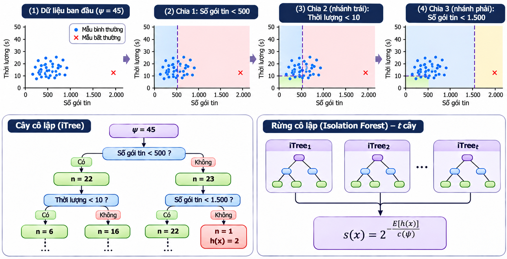

*Hình 1.1. Minh họa cây cô lập và điểm bất thường của Isolation Forest: mẫu bất thường nằm xa vùng dữ liệu dày nên bị tách riêng sau 2 lần chia (h(x) = 2), các nhánh chứa mẫu bình thường còn phải chia tiếp.*

- **Cây cô lập (iTree)**: dựng trên một mẫu con ψ điểm lấy ngẫu nhiên, không lặp, từ tập huấn luyện. Tại mỗi nút, thuật toán chọn ngẫu nhiên một đặc trưng còn biến thiên và một giá trị chia nằm giữa giá trị nhỏ nhất và lớn nhất của đặc trưng đó. Nút thành lá khi còn không quá một điểm, không còn đặc trưng biến thiên hoặc đạt giới hạn độ sâu l = ⌈log₂ ψ⌉.
- **Độ dài đường đi (path length)**: h(x) là số cạnh từ gốc tới lá chứa x. Lá còn n > 1 điểm chưa tách thì h(x) được cộng thêm c(n) = 2H(n − 1) − 2(n − 1)/n, với H(i) ≈ ln(i) + 0,5772, là path length trung bình của một lần tìm kiếm không thành công trong cây nhị phân tìm kiếm có n điểm.
- **Điểm bất thường**: s(x, ψ) = 2^(−E(h(x))/c(ψ)), với E(h(x)) là trung bình h(x) trên t cây. Điểm gần 1 cho thấy x rất bất thường, điểm nhỏ hơn rõ so với 0,5 cho thấy x bình thường, còn nếu mọi điểm đều xấp xỉ 0,5 thì dữ liệu không có bất thường rõ.

Pseudocode của bản tự cài (Hình 3.10 của báo cáo):

```
Fit(X, t, ψ)                      # tập huấn luyện X, số cây t, cỡ mẫu con ψ
  F ← ∅;  l ← ⌈log₂ ψ⌉
  for i = 1..t:
    X' ← ψ điểm lấy ngẫu nhiên, không lặp, từ X
    F ← F ∪ BuildTree(X', 0, l)
  return F

BuildTree(X, h, l)
  if h ≥ l hoặc |X| ≤ 1: return Lá(|X|)
  Q ← các đặc trưng còn biến thiên trong X
  if Q = ∅: return Lá(|X|)
  chọn ngẫu nhiên q ∈ Q và p ∈ [min q, max q]
  return Nút(q, p, BuildTree({x ∈ X : x_q < p}, h + 1, l), BuildTree({x ∈ X : x_q ≥ p}, h + 1, l))

Score(x, F)
  với mỗi cây T ∈ F:  h_T(x) ← số cạnh từ gốc tới lá chứa x + c(số điểm tại lá)
  return s(x) = 2^(−E[h(x)] / c(ψ))
```

### Áp dụng trong đề tài

| Mô hình | Mẫu đưa vào rừng | Số đặc trưng | Mẫu con |
|---|---|---|---|
| Behavior-IF, chiều ra | Cặp máy trong cửa sổ 30 giây | 7 | 65.536 |
| Behavior-IF, chiều vào | Cặp máy trong cửa sổ 30 giây | 5 | 1.024 |
| Web-Query IF | Giá trị tham số truy vấn, trường ngắn của thân POST | 12 | 1.024 |
| Web-Body IF | Văn bản tự do của thân POST | 11 | 1.024 |

Cả bốn rừng dùng 300 cây và seed cố định. Mẫu con là 1.024, riêng rừng chiều ra của Behavior-IF dùng 65.536 vì ngưỡng của nó nằm ở phân vị 99,95% của điểm huấn luyện: mẫu con 1.024 trung bình chỉ chứa 0,5 mẫu nằm ngoài phân vị này, còn mẫu con 65.536 chứa khoảng 33 mẫu. Nhờ mẫu con, chi phí huấn luyện không tăng theo kích thước dữ liệu (chiều ra của Behavior-IF có 1.291.533 cửa sổ huấn luyện), còn chi phí chấm mỗi mẫu chỉ phụ thuộc số cây và độ sâu cây, đủ nhanh để chấm trực tuyến luồng sự kiện của Suricata. Hai tính chất này, cùng việc không giả định phân phối cho các đặc trưng có phân bố lệch, là lý do đề tài chọn Isolation Forest thay cho Mahalanobis, One-Class SVM hay LOF (Bảng 2.5 của báo cáo).

Isolation Forest chỉ xếp hạng mức bất thường, nên ngưỡng của mỗi mô hình là phân vị (1 − SCORE_Q) của điểm trên tập huấn luyện. SCORE_Q được chọn trên tập kiểm định trước khi chấm tập kiểm thử: nấc lớn nhất có không quá một cảnh báo nhầm mỗi giờ ở mỗi chiều với Behavior-IF, có FPR kiểm định không quá 0,2% với hai mô hình web. Rừng cũng không cho biết đặc trưng nào gây bất thường, nên mỗi cảnh báo kèm tối đa ba đặc trưng lệch nhiều nhất theo z bền vững, z = (x − median)/(1,4826 × MAD) tính trên tập huấn luyện. Lớp diễn giải này không tham gia tính điểm hay đặt ngưỡng.

### Bản tự cài và bản scikit-learn

`isolationforest.py` cài lại thuật toán bằng NumPy theo bài báo gốc. `anomaly.py` dùng `sklearn.ensemble.IsolationForest` để chấm trực tuyến nhanh hơn. Số liệu của Behavior-IF trong README này tính trên bản scikit-learn, còn số liệu của hai mô hình web tính trên bản tự cài. Hai bản dùng bộ sinh số ngẫu nhiên khác nhau nên dù cùng seed, cây vẫn không trùng nhau; đề tài vì vậy so thứ hạng điểm và quyết định tại ngưỡng thay vì đòi điểm trùng khớp.

| Mô hình | Dữ liệu so | Spearman giữa hai bản |
|---|---|---|
| Behavior-IF, chiều ra | 5.000 cửa sổ kiểm định | 0,9961 |
| Behavior-IF, chiều vào | 5.000 cửa sổ kiểm định | 0,8731 |
| Web-Query IF | 30.668 đơn vị kiểm định | 0,9770 |
| Web-Body IF | 15.053 giá trị kiểm định | 0,9896 |

Hai bản cho cùng quyết định trên cả 3.616 cửa sổ tấn công chiều ra, 98,93% trong 375 cửa sổ tấn công chiều vào, 99,75% request GET và 99,37% request POST (Bảng 3.9 của báo cáo). `anomaly.py` cũng được kiểm tra bằng cách đưa dữ liệu kiểm thử qua đúng đường xử lý của nó. Với Web-App IF, quyết định trùng với bản scikit-learn của notebook trên cả 39.217 request GET và 28.207 request POST. Với Behavior-IF, hai lát 28 giờ của tập kiểm thử được phát lại qua engine: engine phát 113 cảnh báo ở lát chiều ra và 16 ở lát chiều vào, trùng với cách đếm của notebook.

## Chạy lại

Môi trường: Python 3.13. Ô đầu của mỗi notebook cài đúng phiên bản dùng khi chốt số liệu (numpy 2.5.3, scikit-learn 1.9.1, pandas 3.0.5) cùng scipy, matplotlib, joblib và gdown; khác phiên bản thì cây có thể khác đôi chút.

```
python -m venv .venv
.venv\Scripts\pip install jupyter
.venv\Scripts\jupyter nbconvert --to notebook --execute --inplace 1_KLTN_BehaviorIF.ipynb
.venv\Scripts\jupyter nbconvert --to notebook --execute --inplace 2_KLTN_WebAppIF.ipynb
```

Chạy theo số trong tên tệp: `1_KLTN_BehaviorIF.ipynb` trước, vì notebook này tải cả bộ dữ liệu về `data/`; rồi `2_KLTN_WebAppIF.ipynb`, notebook này chỉ đọc `data/` chứ không tự tải. Cả hai cần `behavior_features.py`, `web_features.py` và `isolationforest.py` nằm cùng thư mục. Notebook 1 xuất `net_if_model.joblib` (hai tham chiếu của Behavior-IF), notebook 2 xuất `web_app_if_model.joblib`; chương trình trong `suricata/anomaly/` nạp hai tệp này khi chạy trực tuyến.

## Luồng dữ liệu

Hệ thống chạy theo hai giai đoạn. Ở giai đoạn huấn luyện ngoại tuyến, hai notebook học trên dữ liệu hợp lệ, chọn ngưỡng và xuất hai tệp mô hình. Ở giai đoạn phát hiện trực tuyến, `anomaly.py` nạp hai tệp này, đọc `eve.json` của Suricata_IDS, chấm điểm và ghi cảnh báo kèm các đặc trưng lệch nhiều nhất để Wazuh thu nhận.

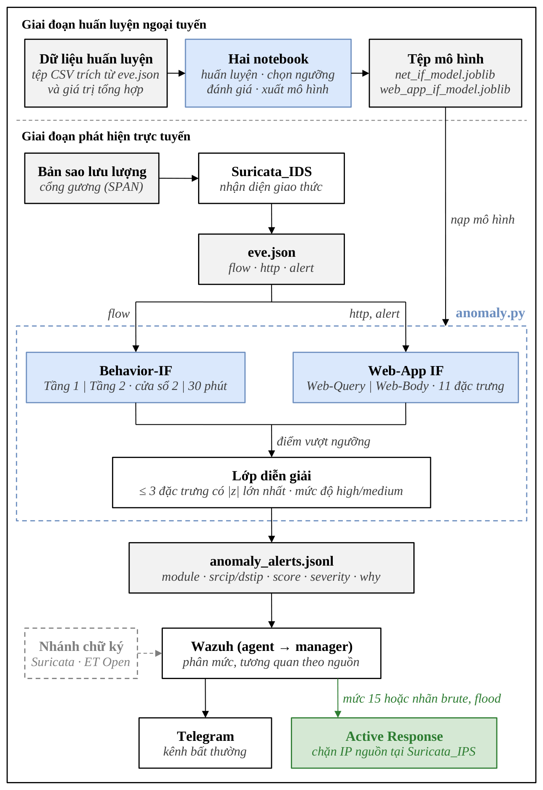

*Hình 3.1. Luồng dữ liệu của nhánh phát hiện bất thường*

## Hạ tầng thực nghiệm

Ba vùng trên EVE-NG: vùng tấn công, vùng nạn nhân (VLAN 10) và vùng quản trị (VLAN 20). Suricata_IPS đặt nội tuyến, Suricata_IDS nhận bản sao qua SPAN và chạy `anomaly.py`.

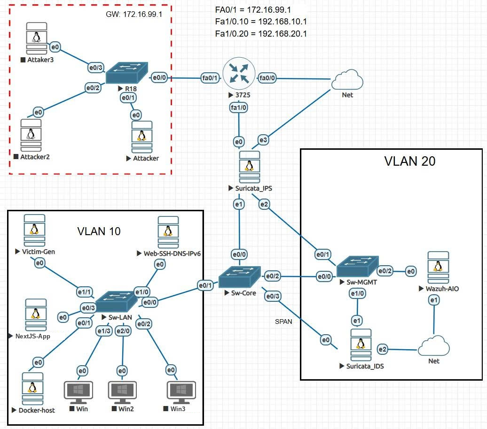

*Hình 3.2. Sơ đồ hệ thống mạng thực nghiệm*

## Cơ chế chấm

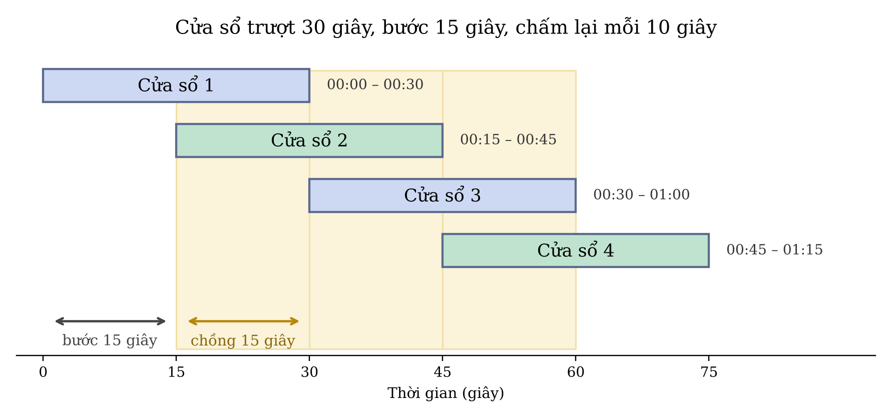

*Behavior-IF, cả hai chiều: chấm lại mỗi 10 giây khi cửa sổ còn mở, báo ngay ở lần đầu điểm vượt ngưỡng. Cửa sổ chốt 75 giây sau thời điểm cuối.*

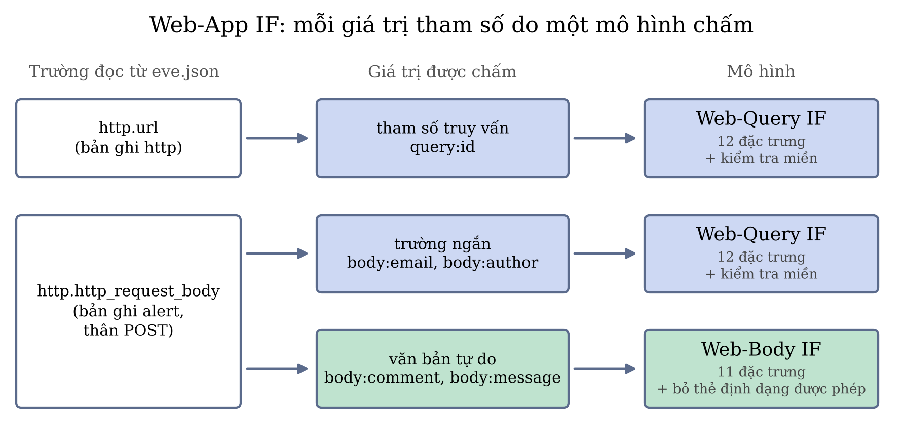

*Web-App IF: trường văn bản tự do xác định theo tên trường (comment, content, message, title…); bước kiểm tra miền gán điểm 1 cho giá trị ngắn có `<`, `>` hoặc `%xx` còn sót.*

## Kết quả trên tập kiểm thử

Mô hình chỉ học trên dữ liệu hợp lệ do đề tài tạo. Ngưỡng được chọn trên tập kiểm định: Behavior-IF theo số cảnh báo nhầm không quá một mỗi giờ ở mỗi chiều, hai mô hình web theo FPR không vượt 0,2%. Tập kiểm thử chỉ dùng để chấm tại ngưỡng đó.

### Behavior-IF

| Chỉ số | Chiều ra | Chiều vào |
|---|---|---|
| Cảnh báo nhầm mỗi giờ, kiểm định / kiểm thử | 0,76 / 0,71 | 0 / 0 |
| Cửa sổ bình thường bị gắn cờ trên tập kiểm thử | 671 / 575.145 (0,117%) | 0 / 17.507 |
| Lượt, phiên tấn công được phát hiện | 413 / 413 | 16 / 16 |
| Cửa sổ tấn công được phát hiện | 3.616 / 3.616 | 351 / 375 |

Behavior-IF phát hiện 429 trong 429 lượt và phiên tấn công của tập kiểm thử, recall theo cửa sổ 99,40%. Nhờ chấm khi cửa sổ còn mở, trung vị độ trễ của các hành vi là 6 đến 114 giây, so với 141 đến 494 giây nếu chỉ chấm lúc cửa sổ đóng (Bảng 3.5 của báo cáo). Độ trễ tính theo giờ thật từ luồng đầu tiên của lượt, phần lớn là thời gian chờ Suricata ghi bản ghi flow. FPR theo cửa sổ của chiều ra là 0,117%. Bộ đặc trưng, độ dài cửa sổ và kích thước mẫu con được chốt sau khi đã xem kết quả trên tập kiểm thử, nên số liệu trên tập này có thể lạc quan hơn thực tế.

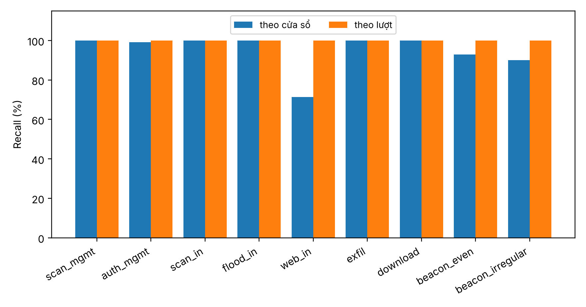

*Hình 3.3. Recall của Behavior-IF theo hành vi trên tập kiểm thử*

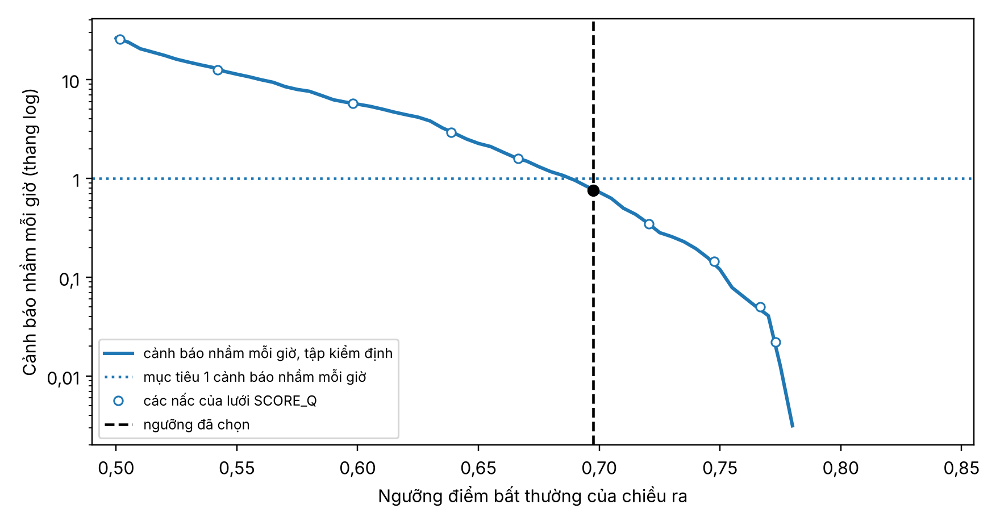

*Hình 3.4. Số cảnh báo nhầm mỗi giờ của chiều ra theo ngưỡng trên tập kiểm định*

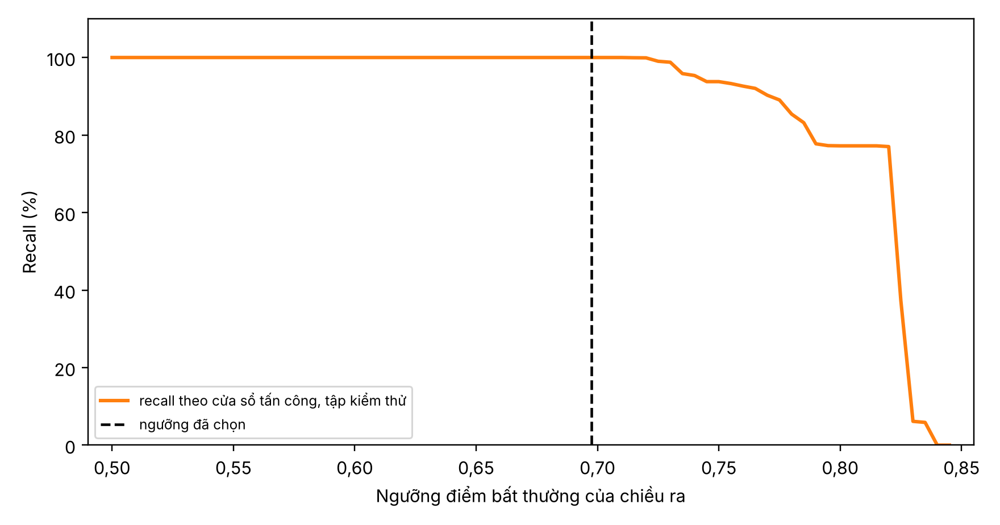

*Hình 3.5. Recall theo cửa sổ tấn công của chiều ra theo ngưỡng trên tập kiểm thử*

### Web-App IF

| Chỉ số | GET | POST |
|---|---|---|
| Tấn công gửi tay trên trang thực nghiệm | 99,78% | 75 / 79 |
| Recall trên tập kiểm thử (bốn loại) | 98,12% | 89,29% |
| Recall riêng SQL Injection và XSS | 99,49% | 95,95% |
| FPR trên request hợp lệ do script duyệt web tạo | 0% | 0% |
| FPR chung trên tập kiểm thử | 0,426% | 0,509% |

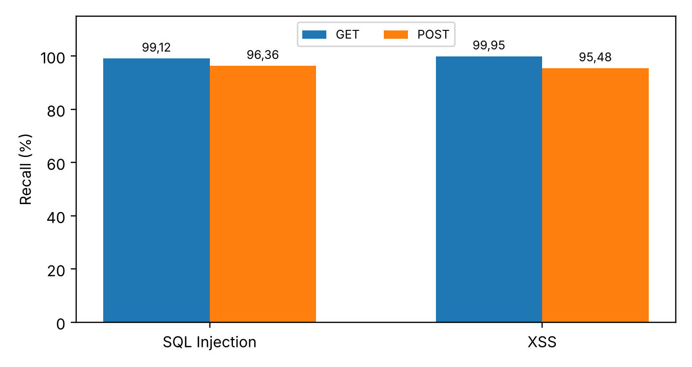

*Hình 3.6. Recall của Web-App IF với SQL Injection và XSS trên tập kiểm thử*

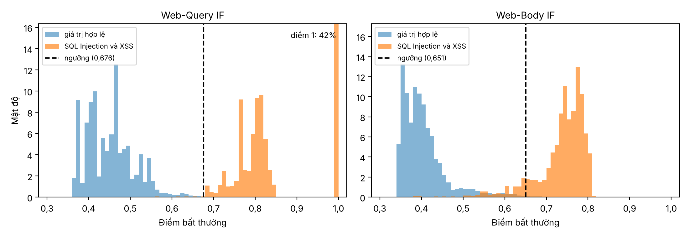

*Hình 3.7. Phân bố điểm của Web-Query IF (trái) và Web-Body IF (phải) với SQL Injection và XSS trên tập kiểm thử*

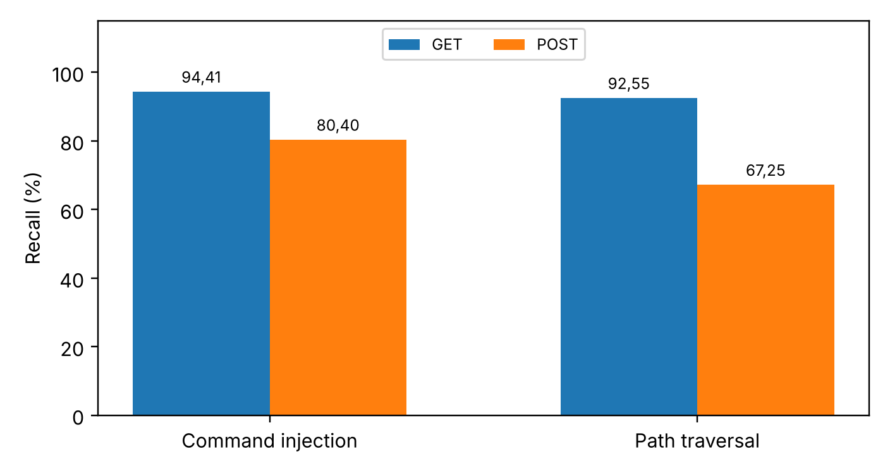

*Hình 3.8. Recall của Web-App IF với command injection và path traversal trên tập kiểm thử*

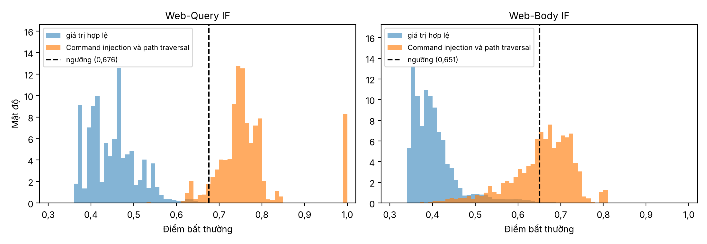

*Hình 3.9. Phân bố điểm của Web-Query IF (trái) và Web-Body IF (phải) với command injection và path traversal trên tập kiểm thử*

Mỗi nửa của hình phân bố điểm so giá trị hợp lệ với giá trị mang tấn công của nhóm, kèm ngưỡng của mô hình; cột ở điểm 1,0 là các giá trị bị bước kiểm tra miền gán điểm 1. SQL Injection và XSS nằm xa ngưỡng ở cả hai mô hình; command injection và path traversal sát ngưỡng hơn, nhất là ở văn bản tự do, và là điểm yếu của mô-đun.

## Xử lý cảnh báo trên Wazuh

Wazuh ghi nhận mỗi cảnh báo ở mức 10 và nâng lên mức 12 khi điểm cao. Cảnh báo Behavior-IF đi nhánh riêng: 100307 ở mức 10, 100308 ở mức 12 khi điểm cao, 100309 ở mức 12 khi cảnh báo mang nhãn brute hoặc flood. Một nguồn có từ 5 cảnh báo trong 300 giây thì lên mức 13 (100311), từ 10 cảnh báo trong 600 giây thì lên mức 15 (100312). Active Response chặn IP nguồn tại Suricata_IPS trong 15 giây theo hai đường: rule 100312 với nguồn tái diễn và rule 100309 với nguồn mang nhãn brute hoặc flood; dò quét chỉ được cảnh báo. Bộ rule và cách cài đặt nằm trong [`wazuh/README_wazuh.md`](wazuh/README_wazuh.md).

Thẻ Telegram chuyển các đặc trưng lệch nhiều nhất thành lời diễn giải tiếng Việt, kèm kỹ thuật MITRE ATT&CK và biện pháp phòng ngừa. Hình 3.12 là thẻ mức 15 nhận được khi chạy SQL Injection vào DVWA, dòng cuối báo nguồn đã bị chặn tạm thời.

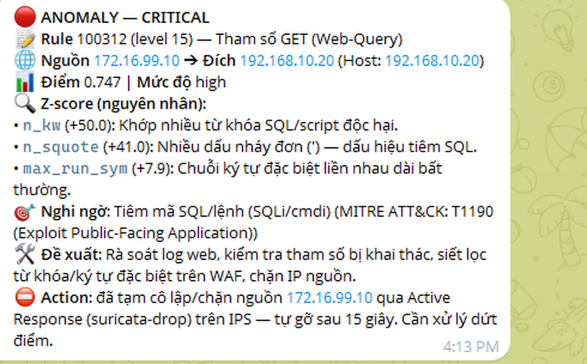

*Hình 3.12. Mẫu thẻ cảnh báo bất thường gửi qua Telegram*

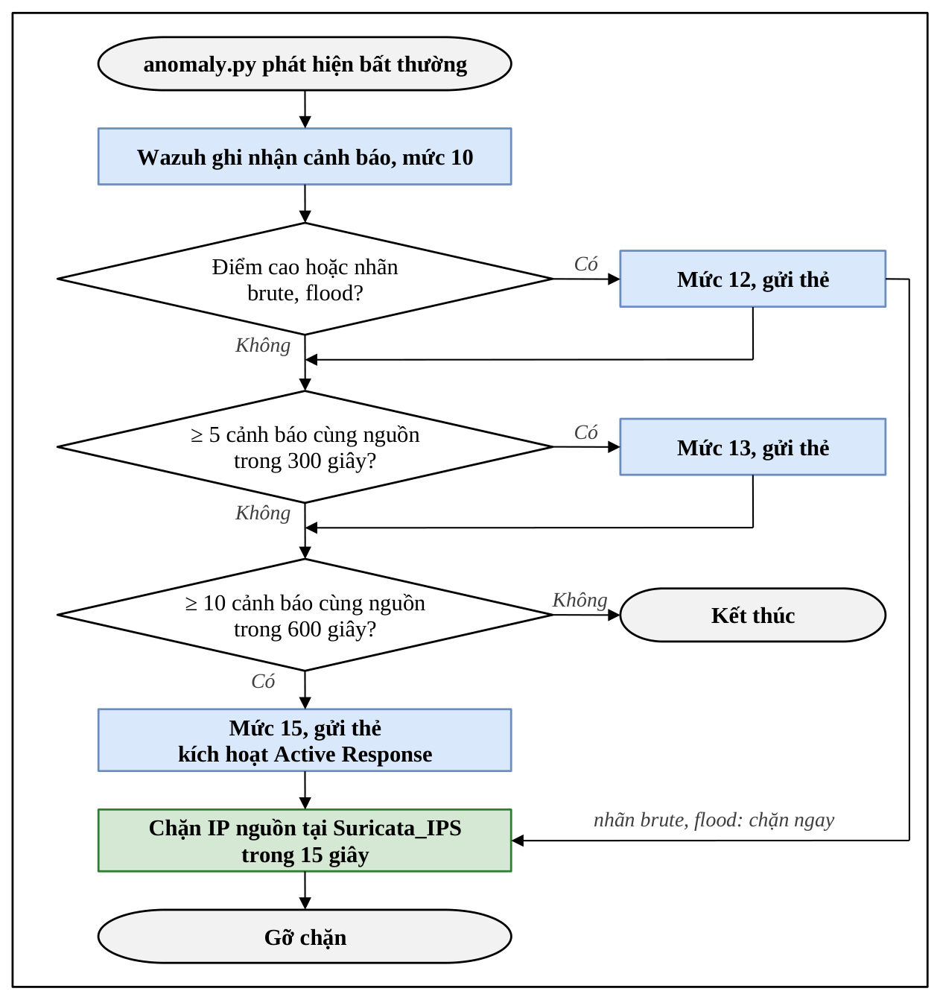

*Hình 3.13. Trình tự cảnh báo, nâng mức và chặn nguồn của nhánh bất thường*

## Thực nghiệm trên hệ thống triển khai

Trên hệ thống thực nghiệm, chuỗi xử lý cảnh báo đã chạy thông: anomaly.py gắn cờ, Wazuh phân mức, thẻ cảnh báo gửi qua Telegram, Active Response chặn nguồn trên Suricata_IPS và tự gỡ chặn khi hết hạn. Các lượt đã chạy (Chương 4 của báo cáo):

| Kịch bản | Mô hình gắn cờ | Điểm | Rule Wazuh | Chặn nguồn |
|---|---|---|---|---|
| Dò quét cổng và dịch vụ, từ ngoài vào | Behavior-IF, chiều vào | 0,768 | 100308 (mức 12) | Không |
| Brute-force SSH | Behavior-IF, chiều vào, nhãn brute | 0,668 | 100309 (mức 12) | Có |
| Làm ngập dịch vụ | Behavior-IF, chiều vào, nhãn flood | 0,727 | 100309 (mức 12) | Rule chặn được thêm rồi gỡ sau 15 giây |
| Dò quét vùng quản trị, từ máy nạn nhân | Behavior-IF, chiều ra | 0,759 | 100308 (mức 12) | Không |
| SQL Injection | Web-Query IF | 0,772 | 100305 (mức 12) | Không |
| XSS lưu trữ | Web-Body IF | 0,713 | 100305 (mức 12) | Không |
| XSS phản chiếu | Web-Query IF, kiểm tra miền | 1,000 | 100305 (mức 12) | Không |
| Command injection | Web-Query IF | 0,670 | 100306 (mức 10) | Không |
| Path traversal | Web-Query IF | 0,725 | 100305 (mức 12) | Không |

Bốn lượt Behavior-IF trong bảng chạy ngày 20/11/2026 với mô hình cửa sổ 30 giây và được báo sau 5 đến 25 giây kể từ luồng đầu tiên của cửa sổ; lượt dò đăng nhập chạy ngay sau lượt dò quét từ cùng nguồn vẫn có cảnh báo riêng. Mỗi lượt web bị gắn cờ ngay từ một request. Chuỗi tấn công web liên tục đạt điều kiện của rule 100312 và bị chặn bốn lần. Các lượt Web-Query IF trong bảng chạy với mô hình trước ngày 19/11/2026 (Web-Query IF 11 đặc trưng) và sẽ được chạy lại với mô hình hiện tại; lượt Web-Body IF dùng rừng và ngưỡng không đổi. Các kịch bản exfiltration và khai thác lỗ hổng sẽ bổ sung khi chạy xong.

## Cấu trúc kho

| Thư mục | Nội dung |
|---|---|
| (thư mục gốc) | Hai notebook huấn luyện `1_KLTN_BehaviorIF.ipynb`, `2_KLTN_WebAppIF.ipynb`; `behavior_features.py`, `web_features.py` (đặc trưng, tách đơn vị, huấn luyện, chấm điểm và chọn ngưỡng của từng mô-đun; notebook nạp và gọi các hàm này); `isolationforest.py` (Isolation Forest tự cài bằng NumPy) |
| `suricata/anomaly/` | Chương trình chạy trực tuyến trên Suricata_IDS: `anomaly.py` (điểm vào), `common.py`, `behavior.py` (Behavior-IF), `web.py` (Web-App IF), `whitelist.txt` (danh sách loại trừ của nhánh hành vi) |
| `suricata/` | Rule thu thân POST, cấu hình eve-log và timeout luồng của Suricata_IDS |
| `wazuh/` | Bộ rule Wazuh, script thông báo Telegram, script Active Response, dịch vụ systemd |
| `docs/` | Hình dùng trong README; các hình kết quả do hai notebook ghi ra |
| `data/` | Đặt bộ dữ liệu vào đây (không đi kèm kho, xem `data/README.md`) |
