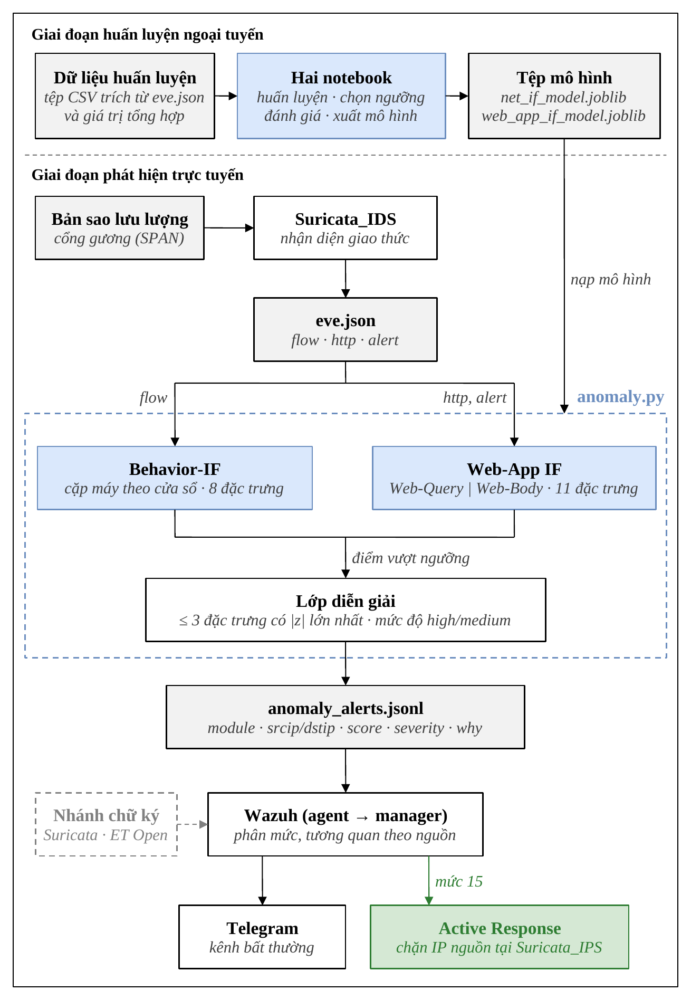
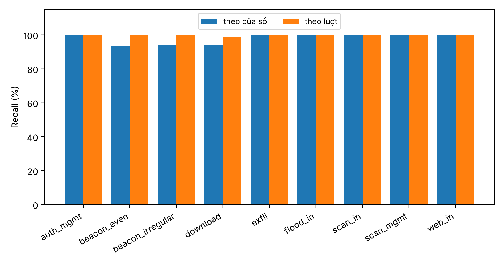
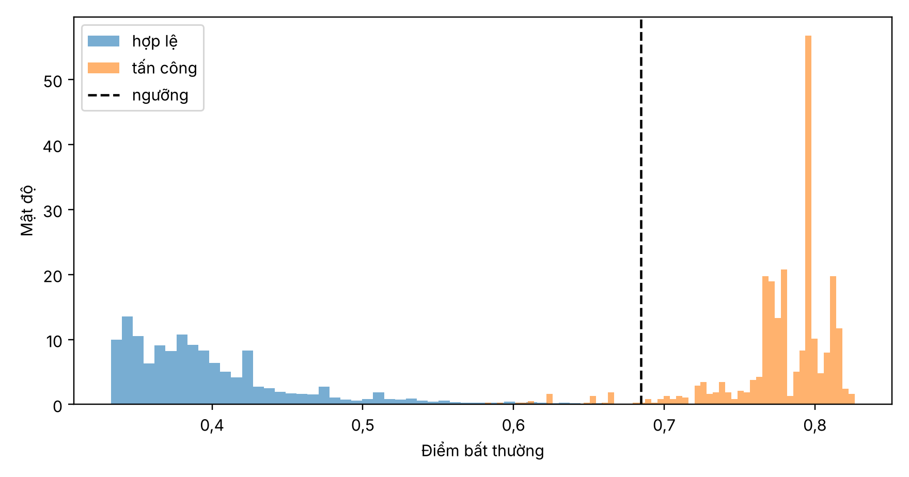
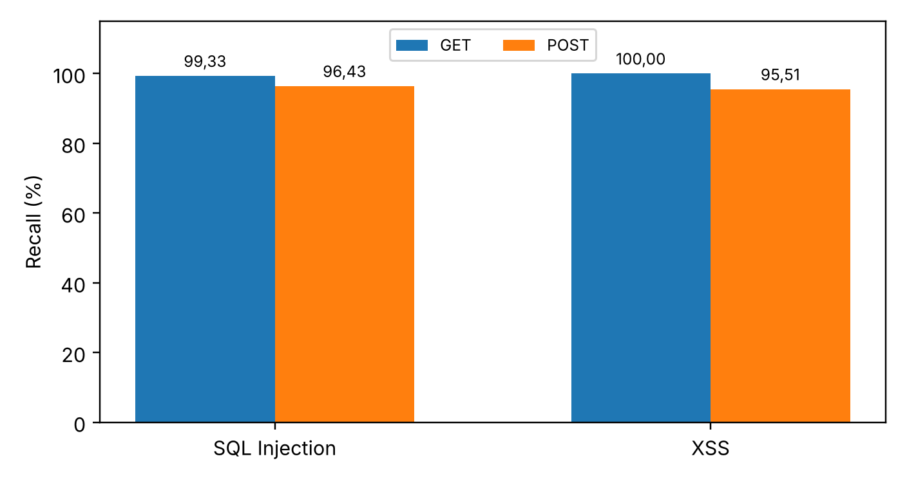
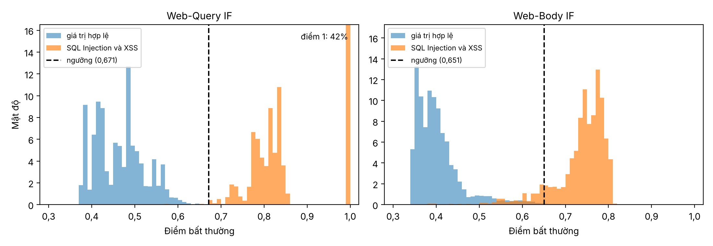
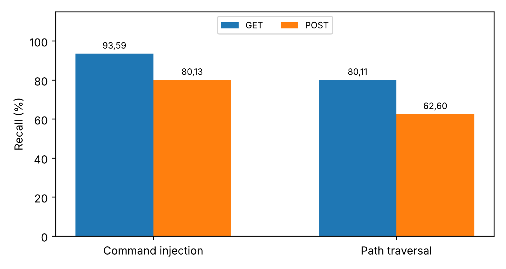
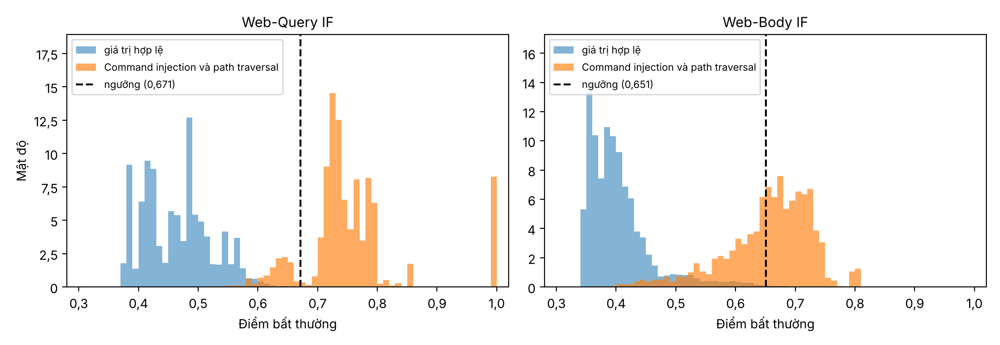
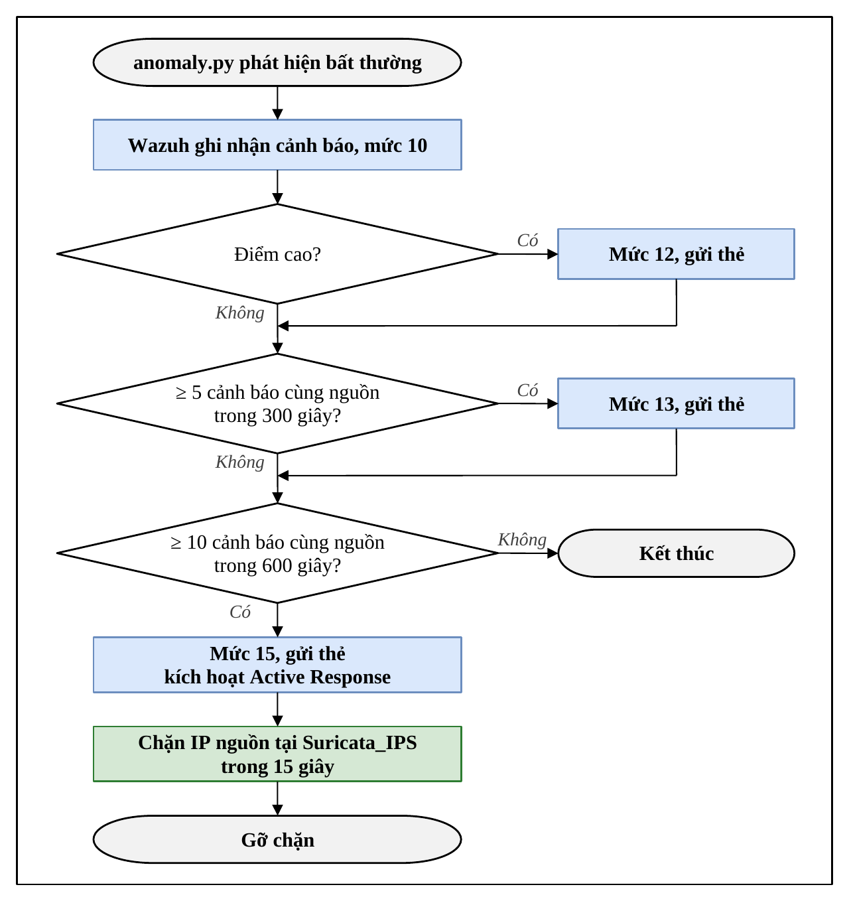
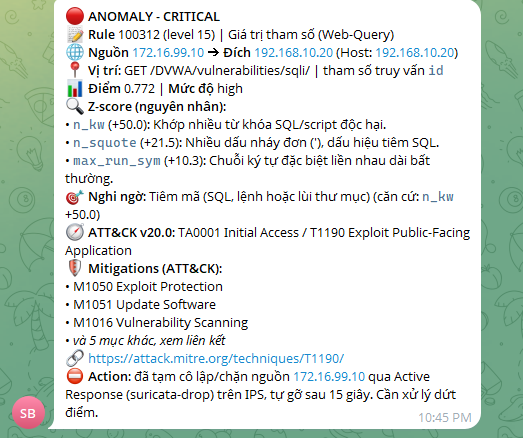
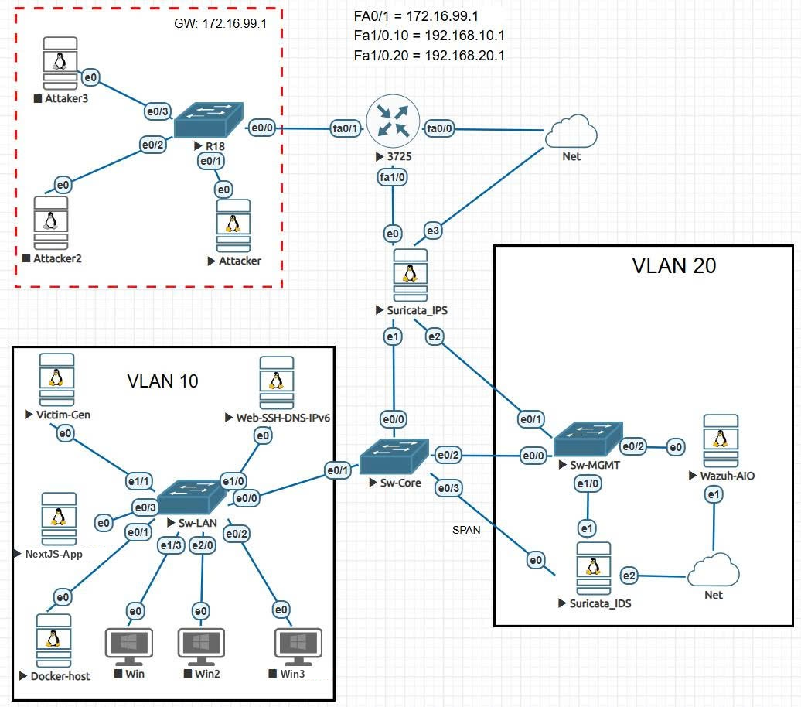

# Isolation Forest phát hiện bất thường từ sự kiện của Suricata

Mã nguồn khóa luận tốt nghiệp **"Nghiên cứu ứng dụng thuật toán Isolation Forest trong phát hiện bất thường từ sự kiện an ninh mạng của Suricata"**.

- Sinh viên: Phạm Lê Hoàng Anh (24TX810002)
- Giảng viên hướng dẫn: ThS. Nguyễn Thanh Nhã

Đề tài xây dựng nhánh phát hiện bất thường chạy song song với nhánh chữ ký của Suricata, gồm hai mô-đun Isolation Forest học không giám sát trên nhật ký `eve.json`:

- **Behavior-IF**: bản ghi `flow`, đơn vị phân tích là cặp máy trong cửa sổ 30 phút, cho cả chiều ra và chiều vào.
- **Web-App IF**: bản ghi `http` và thân POST, đơn vị phân tích là giá trị tham số; gồm Web-Query IF (tham số truy vấn, trường ngắn) và Web-Body IF (văn bản tự do của thân POST). Mô-đun nhắm vào bốn loại tấn công: SQL Injection, XSS, command injection và path traversal, trọng tâm là SQL Injection và XSS.

Cảnh báo được đẩy vào Wazuh, phân loại theo bộ rule riêng, gửi Telegram và có thể chặn nguồn qua Active Response.

## Luồng dữ liệu

Hệ thống chạy theo hai giai đoạn. Ở giai đoạn huấn luyện ngoại tuyến, hai notebook học trên dữ liệu hợp lệ, chọn ngưỡng và xuất hai tệp mô hình. Ở giai đoạn phát hiện trực tuyến, `anomaly.py` nạp hai tệp này, đọc `eve.json` của Suricata_IDS, chấm điểm và ghi cảnh báo kèm các đặc trưng lệch nhiều nhất để Wazuh thu nhận.



## Kết quả trên tập kiểm thử

Mô hình chỉ học trên dữ liệu hợp lệ do đề tài tạo. Ngưỡng của mỗi mô hình được chọn trên tập kiểm định sao cho FPR không vượt 0,2%; tập kiểm thử chỉ dùng để chấm tại ngưỡng đó.

### Behavior-IF

| Chỉ số | Kết quả |
|---|---|
| Lượt và phiên tấn công được phát hiện | 531 / 532 (99,81%) |
| Recall theo cửa sổ | 97,08% |
| FPR chiều ra, tập kiểm định / kiểm thử | 0,141% / 0,146% |
| FPR chiều vào, tập kiểm thử | 0% |
| Cảnh báo nhầm mỗi giờ, kiểm định / kiểm thử | 1,27 / 0,75 |





### Web-App IF

| Chỉ số | GET | POST |
|---|---|---|
| Tấn công gửi tay trên trang thực nghiệm | 99,78% | 97,47% |
| Recall trên tập kiểm thử (bốn loại) | 97,03% | 88,72% |
| Recall riêng SQL Injection và XSS | 99,62% | 96,00% |
| FPR trên request hợp lệ do script duyệt web tạo | 0% | 0% |
| FPR chung trên tập kiểm thử | 0,533% | 0,534% |









Mỗi giá trị tham số do đúng một mô hình chấm: query GET và trường ngắn của POST (email, tên, mã số, trường ẩn của form...) do Web-Query IF chấm (nửa trái của hình phân bố điểm); văn bản tự do của POST (bình luận, nội dung tin nhắn, bài viết) do Web-Body IF chấm (nửa phải). Mỗi nửa so phân bố điểm của giá trị hợp lệ với giá trị mang tấn công của nhóm, kèm ngưỡng của mô hình. Một request bị gắn cờ khi có giá trị vượt ngưỡng của mô hình chấm nó; cột ở điểm 1,0 là các giá trị bị bước kiểm tra miền gán điểm 1. SQL Injection và XSS nằm xa ngưỡng ở cả hai mô hình; command injection và path traversal sát ngưỡng hơn, nhất là ở văn bản tự do, và là điểm yếu của mô-đun.

### Kiểm chứng

- Isolation Forest tự cài xếp hạng gần như trùng scikit-learn (tương quan Spearman 0,981 đến 0,994).
- `anomaly.py` chấm lại toàn bộ tập kiểm thử và cho cùng quyết định với bản scikit-learn trong notebook.

## Xử lý cảnh báo trên Wazuh

Wazuh ghi nhận mỗi cảnh báo ở mức 10 và nâng lên mức 12 khi điểm cao. Khi cùng một nguồn có từ 5 cảnh báo trong 300 giây, cảnh báo lên mức 13; từ 10 cảnh báo trong 600 giây thì lên mức 15. Rule mức 15 gửi thẻ CRITICAL và kích hoạt Active Response chặn IP nguồn tại Suricata_IPS trong 15 giây. Bộ rule và cách cài đặt nằm trong [`wazuh/README_wazuh.md`](wazuh/README_wazuh.md).



## Thực nghiệm trên hệ thống triển khai

Trên hệ thống thực nghiệm, chuỗi xử lý cảnh báo đã chạy thông: anomaly.py gắn cờ, Wazuh phân mức, thẻ cảnh báo gửi qua Telegram, Active Response chặn nguồn trên Suricata_IPS và tự gỡ chặn khi hết hạn. Kết quả theo từng kịch bản tấn công (Chương 4 của báo cáo) sẽ cập nhật sau. Hình dưới là thẻ cảnh báo mức 15 nhận được khi thử SQL Injection vào DVWA, kèm kỹ thuật MITRE ATT&CK và các biện pháp phòng ngừa.



## Hạ tầng thực nghiệm

Ba vùng trên EVE-NG: vùng tấn công, vùng nạn nhân (VLAN 10) và vùng quản trị (VLAN 20). Suricata_IPS đặt nội tuyến, Suricata_IDS nhận bản sao qua SPAN và chạy `anomaly.py`.



## Cấu trúc kho

| Thư mục | Nội dung |
|---|---|
| (thư mục gốc) | Hai notebook huấn luyện `KLTN_BehaviorIF.ipynb`, `KLTN_WebAppIF.ipynb`; `behavior_features.py`, `web_features.py` (đặc trưng, tách đơn vị, huấn luyện, chấm điểm và chọn ngưỡng của từng mô-đun; notebook nạp và gọi các hàm này); `isolationforest.py` (Isolation Forest tự cài bằng NumPy); `anomaly.py` (chấm điểm trực tuyến trên `eve.json`) |
| `wazuh/` | Bộ rule Wazuh, script thông báo Telegram, script Active Response, dịch vụ systemd |
| `suricata/` | Rule thu thân POST và cấu hình eve-log trên Suricata_IDS |
| `docs/` | Hình minh họa trong README; các hình kết quả do hai notebook ghi ra |
| `data/` | Đặt bộ dữ liệu vào đây (không đi kèm kho, xem `data/README.md`) |

## Chạy lại

Môi trường: Python 3.13. Ô đầu của mỗi notebook cài đúng phiên bản dùng khi chốt số liệu (numpy 2.5.3, scikit-learn 1.9.1, pandas 3.0.5) cùng scipy, matplotlib, joblib và gdown; khác phiên bản thì cây có thể khác đôi chút.

Dữ liệu không đi kèm kho mà nằm trong [thư mục Google Drive của đề tài](https://drive.google.com/drive/folders/1QlMZ7_I7ul-gV1yF_Wk-3d1iKvw4RVLd), chỉ chia sẻ đích danh cho người đánh giá vì có các dòng lấy từ HTTP Dataset CSIC 2010, ECML/PKDD 2007 và CTU-13 (xem `data/README.md`). Người được cấp quyền tải các tệp CSV về rồi chép vào `data/`. Liên kết này cũng ghi trong `DRIVE_URL` ở ô cấu hình của hai notebook; khi thiếu dữ liệu, notebook thử tải bằng gdown, nhưng gdown không đăng nhập Google nên chỉ tải được khi thư mục cho phép truy cập theo liên kết.

```
python -m venv .venv
.venv\Scripts\pip install jupyter
.venv\Scripts\jupyter nbconvert --to notebook --execute --inplace KLTN_WebAppIF.ipynb
.venv\Scripts\jupyter nbconvert --to notebook --execute --inplace KLTN_BehaviorIF.ipynb
```

Hai notebook cần `behavior_features.py`, `web_features.py` và `isolationforest.py` nằm cùng thư mục. Mỗi notebook ghi ra một tệp mô hình để `anomaly.py` nạp khi chạy trực tuyến.
